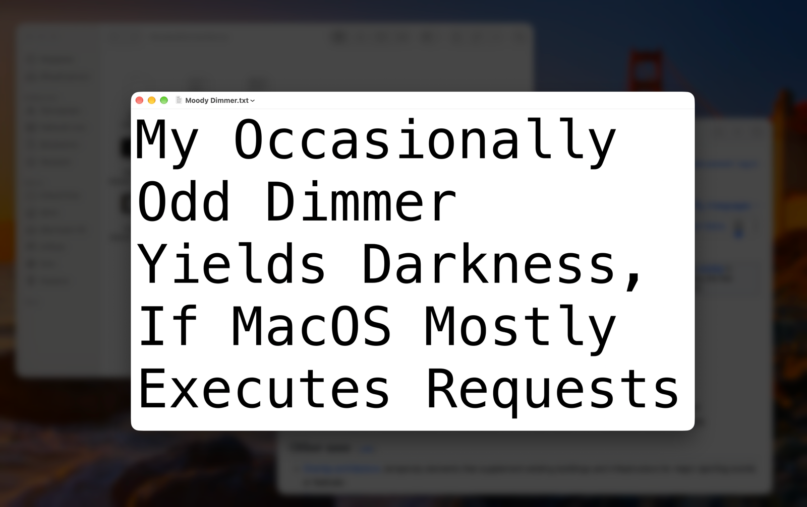

# Moody Dimmer

Бесплатное приложение для строки меню macOS с открытым исходным кодом: затемняет и размывает неактивные окна, чтобы
выделялось только активное. Если знаете HazeOver или Monocle — идея та же.



[English](README.md) · **Русский** · [Español](README.es.md)

_**M**y **O**ccasionally **O**dd **D**immer **Y**ields **D**arkness, **I**f **M**acOS **M**ostly **E**xecutes **R**equests._

- Затемнение, размытие или оба, по желанию с зерном, у каждого своя сила.
- Яркими остаются активное окно или все окна активного приложения.
- Окна, разложенные рядом с активным, остаются яркими вместе с ним.
- Если дисплеев несколько, на каждом остаётся ярким своё верхнее окно.
- По желанию открывает окно, на котором 1,5 секунды задерживается курсор.
- Плавные переходы при смене фокуса, фон не мигает.
- Эффект убирается в полноэкранном режиме, Mission Control и «Показать рабочий стол», при перетаскивании файлов в
  другое приложение и пока вы выбираете, что снять на скриншот. На скриншотах, в записи экрана и при демонстрации
  экрана эффекта нет.
- Быстрое включение сочетанием клавиш (⌃⌥⌘D) или встряхиванием курсора.
- В простое почти ничего не стоит: всё по событиям, без таймеров опроса.
- Английский, русский и испанский.

## Установка

Нужна macOS 26 или новее (разработано и проверено на macOS 27).

- **Homebrew:** `brew install --cask roman1kuz/tap/moody-dimmer`;
  обновление — `brew update && brew upgrade moody-dimmer`.
- **Скачать:** DMG со страницы [Releases](https://github.com/roman1kuz/MoodyDimmer/releases/latest);
  перетащите приложение в «Программы».

Moody Dimmer не нотаризован Apple (для этого нужен платный аккаунт разработчика), поэтому macOS блокирует первый
запуск, а также первый запуск после каждого обновления. Чтобы открыть приложение, зайдите в «Системные настройки →
Конфиденциальность и безопасность» и нажмите «Всё равно открыть». Доступ Accessibility при обновлениях сохраняется.

### Сборка из исходников

Нужны Xcode Command Line Tools (`xcode-select --install`). Собранное самостоятельно приложение открывается без
предупреждения.

```sh
git clone https://github.com/roman1kuz/MoodyDimmer.git && cd MoodyDimmer
./scripts/make-cert.sh             # один раз: локальный сертификат для подписи
./scripts/build-app.sh --install   # сборка, копия в /Applications и запуск
```

Сборка также создаёт DMG в `build/`. Подробнее: [docs/building.ru.md](docs/building.ru.md).

## Разрешения

- **Accessibility**: нужно, чтобы следить за окнами внутри одного приложения (диалоги, второе окно, перемещение
  окон). Без него эффект следует только за переключением между приложениями. Пока доступа нет, в меню есть пункт
  «Дать доступ Accessibility…».
- **Screen Recording**: не нужно.

## Использование

Нажмите на значок в строке меню, чтобы открыть настройки. Эффект включается и выключается переключателем вверху меню,
сочетанием ⌃⌥⌘D или быстро потряся курсором на месте.

## Конфиденциальность

Moody Dimmer сам не выходит в сеть: никакой телеметрии, аналитики и фоновой проверки обновлений. Единственный запрос —
когда вы выбираете «Проверить обновления…»: приложение спрашивает у GitHub номер последней версии и ничего не
скачивает. Доступ Accessibility нужен только для того, чтобы находить активное окно и его положение на экране.

## Документация

- [Настройки](docs/settings.ru.md): все настройки и что они делают.
- [Сборка](docs/building.ru.md): сборка, подпись, иконка приложения.
- [Как это устроено](docs/how-it-works.ru.md): оверлей, отслеживание фокуса, диагностика, ограничения.
- [Производительность и энергопотребление](docs/performance.ru.md): сколько это стоит и как замерено.

## Лицензия

Copyright © 2026 roman1kuz. Moody Dimmer — свободная программа под [GNU General Public License v3.0](LICENSE): её
можно использовать, изучать, менять и распространять, а любая распространяемая версия должна оставаться открытой под
той же лицензией. Название «Moody Dimmer» и иконка приложения под лицензию не подпадают, см.
[TRADEMARK.md](TRADEMARK.md).

Это личный проект, он предоставляется как есть, без каких-либо гарантий. Он опирается на недокументированные механизмы
macOS, поэтому может перестать работать после обновления системы
(см. [ограничения](docs/how-it-works.ru.md#ограничения)).

---

Создано с использованием [Claude](https://claude.ai) от Anthropic.
